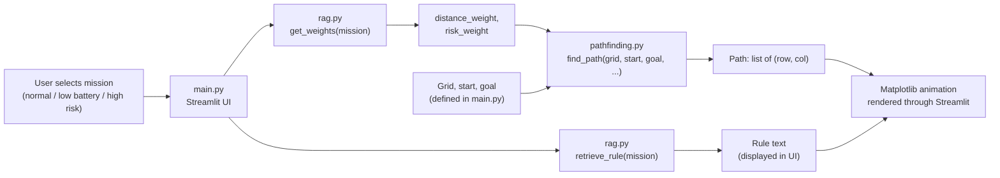

# Drone Path Suggestion System Using RAG-Inspired Rules and A* Pathfinding

A simulated 2D drone navigation project built with Python and Streamlit. The user selects a mission type, a rule-based "retrieval" layer returns a mission rule and a pair of cost weights, and a weighted A* search plans a path across a grid containing free cells, risky cells, and obstacles. The resulting path is animated step by step in the browser using Matplotlib.

> **Scope note:** This is an academic simulation. It does not control, communicate with, or simulate the physics of a real drone. The "RAG" component is a lightweight, rule-based, RAG-inspired layer. It does not use an LLM, embeddings, or a vector database. 
---

## Table of Contents

1. Project Overview
2. Problem Statement
3. Project Objectives
4. Key Features
5. Technologies and Libraries Used
6. System Architecture
7. How the System Works
8. Mission Types
9. Grid Environment
10. Explanation of the RAG-Inspired Decision Layer
11. Explanation of the A* Pathfinding Algorithm
12. Project Folder Structure
13. Installation and Setup
14. Required Dependencies
15. How to Run the Application
16. Screenshots
17. Project Demonstration
18. Limitations
19. Future Improvements
20. Author Information

---

## 1. Project Overview

Drone navigation is rarely just a shortest-path problem. Battery level, area safety, and mission priorities all influence which route is appropriate. This project models that idea in a small, fully simulated environment:

- The environment is a **2D grid** where each cell is free, risky, or blocked.
- A **mission type** (`normal`, `low battery`, or `high risk`) selects a rule and two numeric weights: a distance weight and a risk weight.
- A **weighted A\*** search uses those weights to trade off path length against exposure to risky cells.
- A **Streamlit** interface displays the chosen rule, the path coordinates, and an animated Matplotlib visualization of the drone moving along the path.

## 2. Problem Statement

Standard shortest-path search treats every route the same way regardless of operating context. A drone with a low battery should favor short routes, while a drone on a high-risk mission should accept a longer route to avoid hazardous areas. This project explores how mission context can be translated into cost weights that change the behavior of a pathfinding algorithm.

## 3. Project Objectives

1. Simulate drone navigation in a 2D grid environment.
2. Map a mission type to a mission rule and numeric planning weights.
3. Modify A* so that its step cost depends on a distance weight and a risk weight.
4. Treat obstacles as impassable and risky cells as passable but penalized.
5. Present the result in an interactive web interface with a step-by-step path animation.

## 4. Key Features

- Three selectable mission profiles: normal, low battery, and high risk.
- Rule lookup for each mission, displayed in the interface as "Rule Applied".
- Weighted A* search using a Manhattan distance heuristic and four-directional movement.
- Three cell types: free (`0`), obstacle (`1`), and risky (`2`).
- Animated path visualization in the browser: each step re-renders the grid with the traveled cells in blue.
- Path coordinates printed as a list of `(row, column)` tuples.
- Small, modular codebase: UI, rule layer, and pathfinding are separated into three files.

## 5. Technologies and Libraries Used

| Component | Technology | Role in this project |
|---|---|---|
| Language | Python | Core implementation (developed with Python 3.14) |
| Web interface | [Streamlit](https://streamlit.io/) | Mission selector, button, text output, live-updating plot container |
| Visualization | [Matplotlib](https://matplotlib.org/) | Draws the color-coded grid and path with `imshow` |
| Numerics | [NumPy](https://numpy.org/) | Builds the RGB array used to color the grid |
| Priority queue | `heapq` (standard library) | Open set for A* |
| Other standard library | `time`, `warnings` | Animation delay and warning suppression |

No external LLM, embedding model, vector database, or database connector is used by the application.

## 6. System Architecture



| File | Responsibility |
|---|---|
| `main.py` | Application entry point. Defines the grid, start, and goal; renders the Streamlit UI; calls the rule and pathfinding modules; animates the result with Matplotlib. |
| `rag.py` | `retrieve_rule(mission)` returns a mission rule string. `get_weights(mission)` returns `(distance_weight, risk_weight)`. |
| `pathfinding.py` | `heuristic(a, b)` computes Manhattan distance. `find_path(...)` runs weighted A* and returns the path as a list of `(row, col)` tuples, or an empty list if no path exists. |

## 7. How the System Works

1. **Mission selection.** The user picks a mission type from a Streamlit dropdown.
2. **Generate.** Clicking **Generate Smart Path** triggers the pipeline.
3. **Rule lookup.** `retrieve_rule(mission)` returns the mission rule text.
4. **Weight lookup.** `get_weights(mission)` returns `(distance_weight, risk_weight)` for the mission.
5. **Path planning.** `find_path(grid, start, goal, distance_weight, risk_weight)` runs weighted A* on the grid.
6. **Output.** The interface shows the path coordinates, a mission-specific status message, and the rule text.
7. **Animation.** For each step in the path, a Matplotlib figure is drawn with the grid, the traveled cells in blue, and markers for obstacles, risky cells, the drone, and the goal. The figure replaces the previous one in a Streamlit placeholder with a 0.4 second delay between frames.

## 8. Mission Types

Each mission maps to one rule string and one weight pair. The values below are taken directly from `rag.py`.

| Mission | Rule text | Distance weight | Risk weight |
|---|---|---:|---:|
| Normal | Balance between distance and safety. | 3 | 5 |
| Low Battery | Choose shortest path to save battery. | 10 | 1 |
| High Risk | Avoid risky areas even if path is longer. | 1 | 100 |

In `pathfinding.py`, entering a risky cell adds `risk_weight * 10` on top of the per-step cost of `distance_weight`. The resulting cost of one move is:

| Mission | Move into a free cell | Move into a risky cell |
|---|---:|---:|
| Normal | 3 | 3 + 50 = 53 |
| Low Battery | 10 | 10 + 10 = 20 |
| High Risk | 1 | 1 + 1000 = 1001 |

**Interpretation**

- **Normal:** a moderate risk penalty relative to the step cost.
- **Low Battery:** the risky-cell penalty is only about two steps' worth of cost, so the planner is willing to cross risky cells to save moves.
- **High Risk:** the risky-cell penalty dominates, so the planner takes a longer route if that avoids a risky cell.

### Observed output on the bundled grid

Running the three missions on the grid defined in `main.py` (see [Grid Environment](#9-grid-environment)) produces the same path for all three:

```text
[(0, 0), (1, 0), (1, 1), (1, 2), (2, 2), (2, 3), (2, 4)]
```

This path has 7 cells (6 moves) and crosses no risky cells. On this particular grid, a risk-free route is also a shortest route, so the weights do not change the outcome. The mission profiles differ in cost weights and in the displayed rule and message, but they only produce different paths on grids where the shortest route and the safest route are different.

### Trying a grid where the missions diverge

To see the weights change the result, replace the grid, start, and goal in `main.py` with the following (this configuration was run against the current `rag.py` and `pathfinding.py`):

```python
grid = [
    [0, 0, 0, 0, 0],
    [2, 1, 1, 1, 0],
    [0, 0, 0, 0, 0]
]
start = (0, 0)
goal = (2, 0)
```

| Mission | Path length (cells) | Risky cells crossed |
|---|---:|---:|
| Normal | 11 | 0 |
| Low Battery | 3 | 1 |
| High Risk | 11 | 0 |

Low Battery takes the short route through the risky cell at `(1, 0)`. Normal and High Risk take the longer route around the obstacles.

## 9. Grid Environment

The grid, start, and goal are hardcoded in `main.py`:

```python
grid = [
    [0, 2, 2, 2, 0],
    [0, 0, 0, 2, 0],
    [0, 2, 0, 0, 0]
]
start = (0, 0)   # top-left
goal  = (2, 4)   # bottom-right
```

| Value | Meaning | Handling in `pathfinding.py` | Color in visualization |
|---:|---|---|---|
| `0` | Free cell | Cost of `distance_weight` per move | Green |
| `1` | Obstacle | Skipped, cannot be entered | Red |
| `2` | Risky cell | Passable, adds `risk_weight * 10` | Yellow |
| n/a | Path traveled | n/a | Blue |

Coordinates are `(row, column)`. The default grid contains risky cells but no obstacles. Obstacle handling is implemented in the code and can be exercised by editing the grid.

## 10. Explanation of the RAG-Inspired Decision Layer

**What is implemented.** `rag.py` contains two plain Python functions that use `if / elif / else` branching on the mission string:

- `retrieve_rule(mission)` returns a fixed rule sentence for the mission.
- `get_weights(mission)` returns a fixed `(distance_weight, risk_weight)` tuple for the mission.

**What is not implemented.** The code does not contain:

- a knowledge base of documents or passages,
- keyword scoring, similarity scoring, or ranking,
- embeddings or a vector database,
- a large language model or any text generation step.

**Why it is called "RAG-inspired."** The design follows the retrieval half of the RAG idea at a very small scale: contextual information (a mission rule) is looked up before the decision (path planning) is made, and that context shapes the downstream behavior. It is a deterministic rule lookup, not Retrieval-Augmented Generation in the sense used for LLM systems.

**How the rule relates to the weights.** The rule text returned by `retrieve_rule` is displayed in the interface. The numeric weights are produced separately by `get_weights`, which is also keyed directly on the mission string. The rule text itself does not drive the planner.

## 11. Explanation of the A* Pathfinding Algorithm

`find_path` in `pathfinding.py` is a weighted A* search on a 4-connected grid (up, down, left, right; no diagonal moves).

**Heuristic.** Manhattan distance to the goal:

```text
h(n) = |row_n - row_goal| + |col_n - col_goal|
```

**Cost model.** For a move from `current` to a neighbor:

```text
new_cost = cost_so_far[current] + distance_weight
if grid[neighbor] == 2:
    new_cost += risk_weight * 10
priority = new_cost + h(neighbor)
```

**Procedure**

1. Push the start cell onto a priority queue (`heapq`) with cost 0.
2. Pop the lowest-priority cell. If it is the goal, stop.
3. For each in-bounds neighbor that is not an obstacle (`1`), compute `new_cost`.
4. If the neighbor is unvisited or `new_cost` improves on its best known cost, record it, store its parent in `came_from`, and push it with priority `new_cost + h(neighbor)`.
5. After the search, rebuild the path by following `came_from` from the goal back to the start and reversing it.
6. If the goal was never reached, an empty list is returned.

**Notes**

- Every move costs at least 1 (the weights used are 1, 3, and 10), and the heuristic is not scaled by `distance_weight`, so the heuristic never overestimates and the returned path is cost-optimal for the weighted cost model.
- The implementation has no separate closed set. A cell can be pushed again when a cheaper route to it is found, which does not affect correctness on a grid of this size.

## 12. Project Folder Structure

Recommended layout for the repository:

```text
drone-path-suggestion-system/
├── main.py                  # Streamlit application (entry point)
├── rag.py                   # Mission rule lookup and weight assignment
├── pathfinding.py           # Weighted A* implementation
├── requirements.txt         # Python dependencies
├── README.md
├── .gitignore
├── assets/
│   └── screenshots/         # Screenshots referenced in this README
│       ├── home.png
│       ├── normal-mission.png
│       ├── low-battery-mission.png
│       └── high-risk-mission.png
└── demo/
    └── AI_Project.mp4       # Screen recording of the running application
```

## 13. Installation and Setup

**Prerequisites:** Python 3 and `pip`. The project was developed and run with Python 3.14.

**1. Clone the repository**

```bash
git clone https://github.com/hajra2025/drone-path-suggestion-system.git
cd drone-path-suggestion-system
```

**2. Create and activate a virtual environment (recommended)**

Windows (PowerShell):

```powershell
python -m venv venv
venv\Scripts\Activate.ps1
```

macOS / Linux:

```bash
python3 -m venv venv
source venv/bin/activate
```

**3. Install dependencies**

```bash
pip install -r requirements.txt
```

## 14. Required Dependencies

Third-party packages imported by the application (`main.py`, `rag.py`, `pathfinding.py`):

| Package | Imported in | Purpose |
|---|---|---|
| `streamlit` | `main.py` | Web interface |
| `numpy` | `main.py` | RGB color array for the grid |
| `matplotlib` | `main.py` | Grid and path rendering |

Standard library modules used: `heapq`, `time`, `warnings`.

`requirements.txt`:

```text
streamlit
numpy
matplotlib
```

## 15. How to Run the Application

From the project root, with the virtual environment active:

```bash
streamlit run main.py
```

Streamlit prints a local URL (by default `http://localhost:8501`). Open it in a browser, choose a mission type, and click **Generate Smart Path**.

## 16. Screenshots

> Add your screenshots to `assets/screenshots/` using the file names below.

| Home screen | Normal mission |
|---|---|
|  |  |

| Low battery mission | High risk mission |
|---|---|
|  |  |

## 17. Project Demonstration

A screen recording of the application running locally is included in the repository:

[Watch the demo video](demo/AI_Project.mp4)

The recording shows the project opened in VS Code, the app launched with `streamlit run main.py`, and the normal and low battery missions generating and animating a path.

## 18. Limitations

- **Simulation only.** The system runs in a 2D grid. It does not interface with drone hardware, flight controllers, or real sensors, and it does not model flight dynamics.
- **RAG-inspired, not full RAG.** The decision layer is hardcoded branching on the mission name. There is no document corpus, retrieval scoring, embedding search, vector store, or language model.
- **Rule text does not drive planning.** The displayed rule and the numeric weights are produced by separate functions keyed on the mission name.
- **Fixed environment.** The grid, start, and goal are hardcoded in `main.py`; the user cannot edit them in the interface.
- **Missions may not differ visibly.** On the bundled grid all three missions return the same path (see [Mission Types](#8-mission-types)).
- **Abstract cost model.** There is no battery model, energy estimate, or real risk data. Weights are hand-chosen constants.
- **Movement model.** Only four-directional movement is supported. No diagonal moves, altitude, or 3D planning.
- **No-path handling.** `find_path` returns an empty list when the goal is unreachable, but `main.py` does not display a dedicated "no path found" message; its final success message is shown regardless.
- **Rendering.** The visualization uses emoji characters as Matplotlib text markers. Whether they render depends on the fonts available on the system; in the recorded demo the drone marker appears as a placeholder box on the author's machine. Each animation frame also creates a new Matplotlib figure without explicitly closing it.
- **No automated tests or benchmarks.** The repository reports no accuracy scores or performance measurements.

## 19. Future Improvements

- Replace the rule lookup with an actual retrieval layer (for example, a small document store with keyword or embedding-based retrieval) and derive the weights from the retrieved rule text.
- Add a user-editable grid and selectable start and goal cells in the Streamlit interface.
- Add a clear "no path found" state in the interface.
- Introduce a simple battery model so that low-battery behavior depends on remaining energy rather than a fixed weight pair.
- Support diagonal movement and compare alternative planners (Dijkstra, Theta*, D* Lite).
- Add unit tests for `retrieve_rule`, `get_weights`, and `find_path`, including unreachable-goal and obstacle cases.
- Support larger and randomly generated maps, and display path cost and risk exposure alongside the path.
- Close Matplotlib figures after each frame and use font-independent markers.

## 20. Author Information

**Hajra Bahoo**
BS student, PAF-IAST (Pak-Austria Fachhochschule: Institute of Applied Sciences and Technology), Haripur
Artificial Intelligence course project, Spring 2026
Instructor: Abdullah Sajid

GitHub: [hajra2025](https://github.com/hajra2025)
Repository: [drone-path-suggestion-system](https://github.com/hajra2025/drone-path-suggestion-system)
